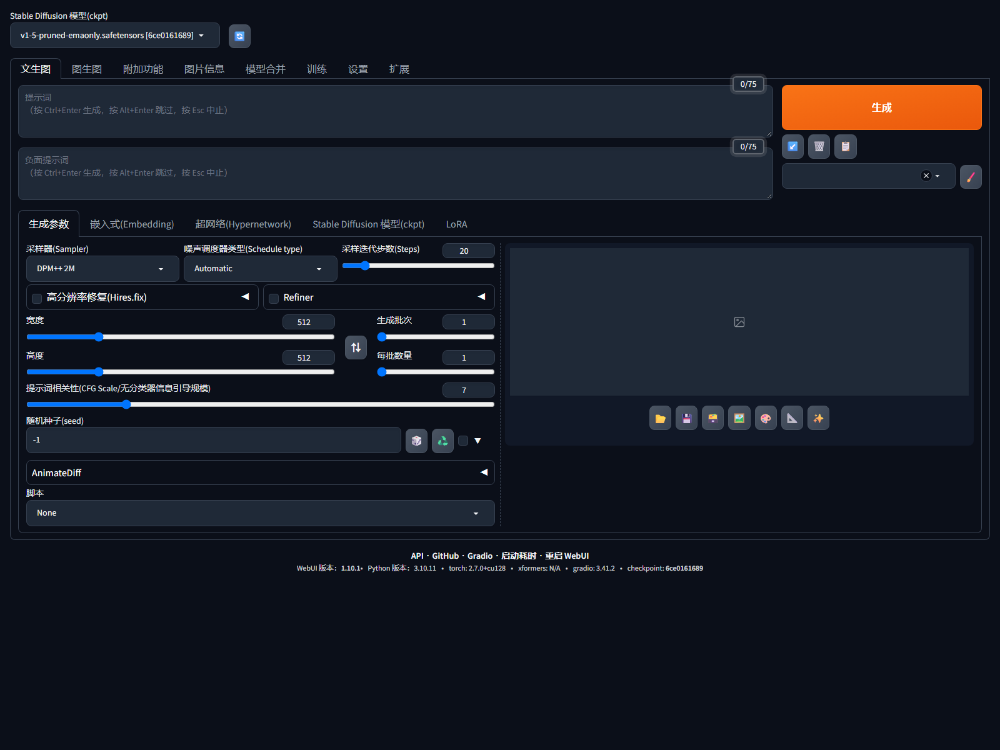

# SD WebUI One-click CN

在 Windows 上一次性装好 **AUTOMATIC1111 Stable Diffusion WebUI + AnimateDiff V2 + 简体中文界面** 的安装脚本。

不需要预装 Python 或 Git，不需要手动编译，不需要从 GitHub 下载几 GB 的整合包。脚本会使用便携版 Python 3.10.11，从国内镜像下载 PyTorch、模型和扩展；没有 Git 时自动用 codeload ZIP 获取 WebUI 和扩展。

> 已在 **Windows 11 / RTX 5070 Laptop 8GB / NVIDIA 617.42 / Python 3.10.11** 上完整跑通：
> 文生图 512×512、AnimateDiff 8 帧 GIF、中文界面均已验证。



---

## 这个仓库会装什么

| 组件 | 版本 / 来源 | 说明 |
| --- | --- | --- |
| AUTOMATIC1111 WebUI | `dev` 分支，固定提交 `1937682a`（v1.10.1） | 主程序，运行时获取；`git clone` 失败会自动改用 codeload ZIP，不随仓库分发 |
| Python | 3.10.11 embeddable | 便携版，解压到 `_python310\`，不污染系统 Python |
| PyTorch | 2.7.0 + cu128 / torchvision 0.22.0 | 支持 RTX 50 系（sm_120 / Blackwell） |
| 基础模型 | SD 1.5 `v1-5-pruned-emaonly.safetensors` | 4.27 GB，ModelScope 镜像 |
| AnimateDiff | `continue-revolution/sd-webui-animatediff` + `mm_sd_v15_v2.ckpt` | 让 SD1.5 生成连贯短视频 |
| 中文语言包 | `dtlnor/stable-diffusion-webui-localization-zh_CN`（`Anne` 分支） | 默认启用 `zh_CN` |
| CLIP 文本编码器 | `openai/clip-vit-large-patch14` | 预置到本地缓存，首次加载不需要连 HuggingFace |

仓库本身只有脚本、文档和两个 bootstrap 文件（pip wheel 与 CLIP 源码 zip），**不包含任何模型权重**。

---

## 环境要求

- Windows 10 1809+ / Windows 11，64 位
- [Git for Windows](https://git-scm.com/download/win)（可选；检测不到 Git 时会自动改用 codeload ZIP，无需手动安装）
- PowerShell 5.1（Windows 自带）
- 至少 **20 GB** 可用磁盘空间（推荐 25 GB）
- NVIDIA 显卡与驱动：
  - 推荐驱动 **570 或更高**（CUDA 12.8）
  - 显存 **8 GB 起**；6 GB 可以跑 512×512 文生图，但 AnimateDiff 需要降低分辨率/帧数
- 能访问 GitHub（`git clone` 或 `codeload.github.com` ZIP 任一可用；脚本会自动回退）以及国内镜像（SJTU / 华为云 / ModelScope / 清华 PyPI）

没有 NVIDIA 显卡也可以 `-Cpu` 安装 CPU 版 PyTorch，但生成速度会非常慢，不推荐日常使用。

---

## 快速开始

### 1. 获取本仓库

```bat
git clone https://github.com/Dragon-ts/sd-webui-oneclick-cn.git
cd sd-webui-oneclick-cn
```

也可以直接在 GitHub 页面点 **Code → Download ZIP** 解压。ZIP 方式没有 `.git`，不影响安装；WebUI 和扩展若 `git clone` 失败，会自动改用 codeload ZIP。

### 2. 运行安装

双击：

```bat
install.bat
```

或在 PowerShell / CMD 中：

```bat
install.bat
```

安装过程会依次：

1. 检查 64 位系统、Git、显卡和磁盘空间
2. 下载并解压 Python 3.10.11
3. 引导 pip，获取 A1111 WebUI（`git clone`，失败则 codeload ZIP）并切到固定提交
4. 安装 PyTorch 2.7.0 + cu128（约 3.3 GB）
5. 安装 WebUI 依赖、CLIP、AnimateDiff 依赖
6. 安装 AnimateDiff 与中文语言包（同样支持 ZIP 回退）
7. 下载 SD1.5（约 4.0 GB）和运动模块（约 1.7 GB）
8. 预置 CLIP 缓存（约 1.7 GB）
9. 写入 `config.json`，生成 `start_sd.bat`

首次安装总下载量约 **10–11 GB**，具体取决于是否跳过模型。中断后重新运行会尽量续传/跳过已完成的部分。

### 3. 启动

```bat
start_sd.bat
```

浏览器打开 <http://127.0.0.1:7860>。首次启动加载模型约 1–3 分钟。

---

## 常用参数

`install.bat` 会把参数原样传给 `install.ps1`：

```bat
install.bat -InstallDir D:\sd\webui -CacheDir D:\sd\cache
install.bat -MotionModulePath D:\models\mm_sd_v15_v2.ckpt
install.bat -SkipModels -SkipClipCache
install.bat -Cpu
install.bat -ForceZip
install.bat -CheckOnly
```

| 参数 | 默认值 | 作用 |
| --- | --- | --- |
| `-InstallDir` | `.\stable-diffusion-webui` | WebUI 安装目录 |
| `-PythonDir` | `.\_python310` | 便携 Python 目录 |
| `-CacheDir` | `.\_cache` | HuggingFace / Torch / Matplotlib 缓存 |
| `-MotionModulePath` | 自动查找 | 指定本地 `mm_sd_v15_v2.ckpt` |
| `-WebUiCommit` | `1937682a` | 固定 WebUI 提交；一般不需要修改 |
| `-SkipModels` | 关 | 不下载 SD1.5 |
| `-SkipMotionModule` | 关 | 不下载 AnimateDiff 运动模块 |
| `-SkipClipCache` | 关 | 不预置 CLIP 缓存（首次加载可能联网） |
| `-Cpu` | 关 | 安装 CPU 版 PyTorch（很慢） |
| `-ForceZip` | 关 | 跳过 `git clone`，直接用 codeload ZIP 获取 WebUI 和扩展 |
| `-CheckOnly` | 关 | 只打印解析后的路径，不做修改 |
| `-Launch` | 关 | 安装完成后直接启动 WebUI |
| `-NoPause` | 关 | 出错时不等待回车（适合自动化） |

安装完成后，`start_sd.bat` 也接受额外参数，例如：

```bat
start_sd.bat --medvram
start_sd.bat --listen --gradio-auth user:password
start_sd.bat --xformers
```

---

## 目录结构

```text
sd-webui-oneclick-cn\
├─ install.bat              ← 双击安装
├─ install.ps1              ← 安装逻辑
├─ start_sd.bat             ← 安装时生成，启动 WebUI
├─ vendor\
│  ├─ pip-24.2-py3-none-any.whl
│  └─ clip-openai.zip
├─ docs\preview.png
├─ _python310\              ← 安装后生成，便携 Python
├─ _downloads\              ← 安装后生成，下载缓存
├─ _cache\                  ← 安装后生成，HF/Torch 缓存
└─ stable-diffusion-webui\  ← 安装后生成，A1111 本体
   ├─ models\Stable-diffusion\v1-5-pruned-emaonly.safetensors
   ├─ extensions\sd-webui-animatediff\model\mm_sd_v15_v2.ckpt
   └─ extensions\stable-diffusion-webui-localization-zh_CN\
```

---

## 中文界面

安装脚本会写入：

```json
{
  "sd_model_checkpoint": "v1-5-pruned-emaonly.safetensors [6ce0161689]",
  "localization": "zh_CN"
}
```

启动后应直接显示中文。如果没有：

1. 打开 **Settings → User interface → Localization**
2. 选择 `zh_CN`
3. 点击 **Apply settings**，然后 **Reload UI**（或重启）

第三方扩展（如 AnimateDiff）的面板标题可能仍是英文，这是扩展本身没有翻译，不影响使用。

---

## AnimateDiff 怎么用

1. 在 **文生图** 页面展开 **AnimateDiff** 面板
2. 勾选 **Enable AnimateDiff**
3. Motion module 选择 `mm_sd_v15_v2.ckpt`
4. 建议参数：
   - 分辨率：`512×512`
   - 帧数：`8`（8GB 显存最稳）；`16` 可能需要 `--medvram` 或 `384×384`
   - FPS：`8`
   - 采样步数：`15–20`
5. 生成后在输出目录得到 GIF / PNG 序列

8GB 显存实测：8 帧、512×512、15 步约 40–50 秒。显存不足时：

```bat
start_sd.bat --medvram
```

或者把帧数降到 8、分辨率降到 384×384。

> `mm_sd_v15_v2.ckpt` 是 **运动模块**，不是完整模型，必须放在 AnimateDiff 扩展的 `model\` 目录，不能放进 `models\Stable-diffusion`。

---

## 局域网访问（可选，默认关闭）

默认只监听 `127.0.0.1:7860`，同一局域网的其他设备无法访问。需要时：

```bat
start_sd.bat --listen --gradio-auth user:password
```

然后在本机用**管理员** PowerShell 添加入站规则：

```powershell
New-NetFirewallRule -DisplayName "SD WebUI 7860" `
  -Direction Inbound -Protocol TCP -LocalPort 7860 `
  -Action Allow -Profile Private,Public `
  -RemoteAddress 10.0.0.0/8,172.16.0.0/12,192.168.0.0/16
```

其他设备访问 `http://<本机局域网IP>:7860`。

**安全提醒：**

- 一定要设置 `--gradio-auth`，否则同网段任何人都能操作你的 WebUI
- WebUI 可以安装扩展，扩展等于任意代码执行；不要直接暴露到公网
- 更安全的方式是 SSH 隧道：`ssh -L 7860:127.0.0.1:7860 user@host`
- 校园网/公司网络可能开启 AP 隔离，设备之间无法互访，需要换成手机热点或让网管放行

---

## 常见问题

### 卡在 `git clone` / `Failed to connect to github.com:443 over proxy`

脚本检测到克隆失败后，会先清空 `HTTP_PROXY/HTTPS_PROXY/ALL_PROXY` 并用 `-c http.proxy=` 重试一次。仍然失败时会自动改用 `codeload.github.com` 的 ZIP 下载 WebUI 和两个扩展；也可以主动加 `-ForceZip` 跳过 git：

```bat
install.bat -ForceZip
```

如果 ZIP 也失败：

1. 用浏览器打开 `https://codeload.github.com/AUTOMATIC1111/stable-diffusion-webui/zip/refs/heads/dev`，确认能否下载
2. 确认代理软件正在运行，或关闭系统代理后重试
3. 如果 GitHub 完全不可用，需要先解决网络问题；脚本需要 git 或 codeload 至少一个可用

ZIP 安装没有 `.git`，不影响生成图片，但之后不能用 `git pull` 更新 WebUI；重新运行安装脚本会复用已有目录。

### 下载到一半失败

重新运行 `install.bat`。`curl` 会尝试断点续传，已经完整的文件会跳过。若文件大小校验失败，删除对应文件后重试：

```text
_downloads\
stable-diffusion-webui\models\Stable-diffusion\v1-5-pruned-emaonly.safetensors
stable-diffusion-webui\extensions\sd-webui-animatediff\model\mm_sd_v15_v2.ckpt
```

### `CUDA out of memory`

```bat
start_sd.bat --medvram
```

或降低分辨率/帧数。8GB 显存不要一上来就跑 16 帧 768×768。

### 启动报 `No module named 'modules'`

便携 Python 的 `python310._pth` 没有包含 WebUI 目录。重新运行 `install.bat` 即可修复；也可以手动在 `_python310\python310._pth` 末尾加入 WebUI 的绝对路径。

### 加载模型时卡在 CLIP / 报 `Could not find openai/clip-vit-large-patch14`

确认 `_cache\huggingface\hub\models--openai--clip-vit-large-patch14\snapshots\...` 下有 7 个文件且大小正确。删除整个 `_cache\huggingface` 后重新运行：

```bat
install.bat -SkipModels -SkipMotionModule
```

### 中文没生效

见上面的“中文界面”一节。修改语言后必须 **Reload UI** 或重启，因为语言表是在页面加载时注入的。

### 端口 7860 被占用

```bat
start_sd.bat --port 7861
```

---

## 许可与声明

- 本仓库的安装脚本以 **MIT** 发布，见 [LICENSE](LICENSE)。
- 仓库内 `vendor\pip-24.2-py3-none-any.whl` 与 `vendor\clip-openai.zip` 是第三方 bootstrap 文件，分别遵循 MIT 许可；详见 [NOTICE.md](NOTICE.md)。
- **不包含** A1111 源码、模型权重或扩展代码；这些内容在安装时从上游下载，遵循各自许可证：
  - AUTOMATIC1111 WebUI：AGPL-3.0
  - SD 1.5 权重：CreativeML Open RAIL-M
  - AnimateDiff 扩展代码：CC BY-NC-SA 4.0（**禁止商业使用**，请自行确认）
  - 中文语言包：MIT
- 使用模型生成的内容请遵守模型许可和当地法律。作者不对生成内容承担责任。

---

## 参考

- [AUTOMATIC1111/stable-diffusion-webui](https://github.com/AUTOMATIC1111/stable-diffusion-webui)
- [continue-revolution/sd-webui-animatediff](https://github.com/continue-revolution/sd-webui-animatediff)
- [dtlnor/stable-diffusion-webui-localization-zh_CN](https://github.com/dtlnor/stable-diffusion-webui-localization-zh_CN)
- [guoyww/animatediff](https://huggingface.co/guoyww/animatediff)
- [openai/CLIP](https://github.com/openai/CLIP)

如果这个脚本帮你省了时间，欢迎点个 Star。
